<p align="center">
  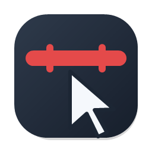
</p>

<h1 align="center">MouseFence</h1>

<p align="center">
  <strong>Keep the mouse pointer on the screen you meant to use.</strong><br>
  A small Windows tray app that puts gentle fences between your monitors.
</p>

<p align="center">
  <a href="https://github.com/ydbilgin/MouseFence/releases/latest"></a>
  <a href="https://github.com/ydbilgin/MouseFence/releases"></a>
  
  
  <a href="LICENSE"></a>
</p>

<p align="center">
  
</p>

<p align="center">
  <a href="https://github.com/ydbilgin/MouseFence/releases/latest"><strong>Download</strong></a>
  &nbsp;·&nbsp; <a href="#install">Install</a>
  &nbsp;·&nbsp; <a href="#everyday-use">Everyday use</a>
  &nbsp;·&nbsp; <a href="#questions-and-troubleshooting">Troubleshooting</a>
  &nbsp;·&nbsp; <a href="#build-from-source">Build</a>
</p>

## The problem

With more than one monitor, the pointer slips onto the wrong screen all the time. A screen above your main
one catches it every time you aim for a tab or a title bar near the top edge. A side screen pulls it out of a
borderless game in the middle of a fight. Windows has no setting for "only cross when I mean it".

MouseFence adds that setting. It leaves your Windows display layout exactly as it is and only decides what
happens when the pointer reaches the edge between two screens.

## What it does

Click the small gate between two screens and choose what that edge does:

| Edge behaviour | What it feels like |
|---|---|
| **Crosses freely** | A normal Windows monitor edge. |
| **Needs a firm push** | Slow drift stops at the edge; one deliberate push crosses. |
| **Never crosses** | The pointer stays on its side. |

Each direction can behave differently: for example, going up into the top screen needs a firm push, while
coming back down crosses freely. A screen you mark **Keep pointer off** is never entered at all, but Windows
keeps using it as normal.

- **Upward and side protection** for screens above, left or right of your main screen.
- **Game mode** keeps the pointer on whichever screen it is on, for windowed and borderless games.
- **Pause** turns every fence off until you resume.
- **Global shortcuts** for all four, plus a tray menu that shows which are on.
- **Safety:** if your screen layout changes, MouseFence will not leave the pointer locked onto one screen.
- **Light, Dark or system theme**, English and Turkish, settings backup and restore.
- **Small and local:** a single-instance tray app, DPI-aware, no installer, no network access, and it never
  changes your display settings.

## Install

1. Download **`MouseFence-win-x64.exe`** from the [latest release](https://github.com/ydbilgin/MouseFence/releases/latest).
2. Install the [.NET 9 Desktop Runtime](https://dotnet.microsoft.com/download/dotnet/9.0) if you do not have it
   yet (the release file is small because it uses the shared runtime).
3. Put the file anywhere, for example `%LOCALAPPDATA%\Programs\MouseFence\`, and run it. It starts in the
   system tray and opens no window.
4. To start it with Windows, turn on **Settings → General → Start with Windows**.

The pictures in this README show the current code on `main`, which has a refreshed look (themed tray menu,
cleaner settings rows). The latest release, v1.1.1, works the same but looks slightly older. To get the new
look today, [build from source](#build-from-source); it arrives in the next release.

## Everyday use

**First setup**

1. Right-click the tray icon and choose **Settings**. **Displays** shows your screens as Windows arranges them.
2. Optionally name each screen, or tick **Keep pointer off** for a screen the pointer should never enter.
3. Click a small gate where two screens meet, choose **Crosses freely**, **Needs a firm push** or
   **Never crosses**, and select **Save**.

**Crossing a firm-push edge:** move to the middle of the shared edge and push straight across in one motion.

**Tray icon**

- Double-click it to open or close upward passage.
- Right-click it for the menu:

<p align="center">
  <picture>
    <source media="(prefers-color-scheme: dark)" srcset="docs/screenshots/tray-menu-dark.png">
    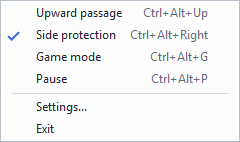
  </picture>
</p>

**Default shortcuts** (change them in **Settings → Shortcuts**):

| Action | Shortcut |
|---|---|
| Upward passage on or off | `Ctrl + Alt + Up` |
| Side protection on or off | `Ctrl + Alt + Right` |
| Game mode | `Ctrl + Alt + G` |
| Pause MouseFence | `Ctrl + Alt + P` |

On a fresh install on a PC with Intel graphics, MouseFence adds `Shift` to the two arrow shortcuts, because
the Intel driver uses `Ctrl + Alt + arrow` to rotate the screen.

**Where things are kept**

| What | Where |
|---|---|
| Settings | `%APPDATA%\MouseFence\settings.json` (plain JSON; delete it to reset) |
| Error log | `%APPDATA%\MouseFence\error.log` (small, size-limited) |

<details>
<summary><strong>See every Settings page in Light and Dark</strong></summary>

The pictures use a made-up three-screen layout (Main 2560 × 1440, Top above it, Laptop to the right), not
anyone's real monitors.

### Displays

<p>
  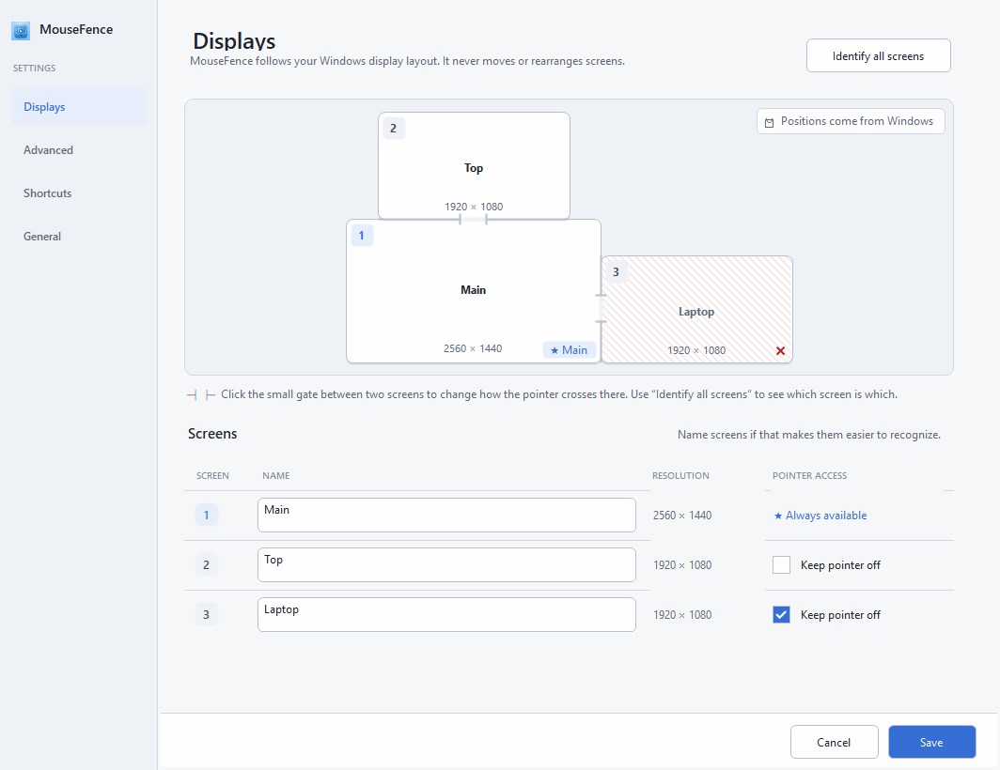
  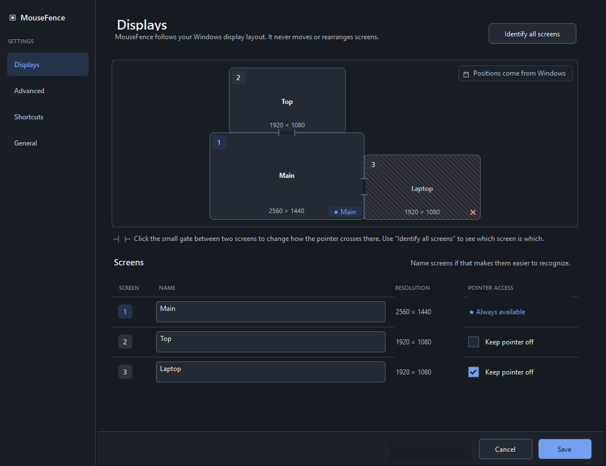
</p>

### Choosing what an edge does

<p>
  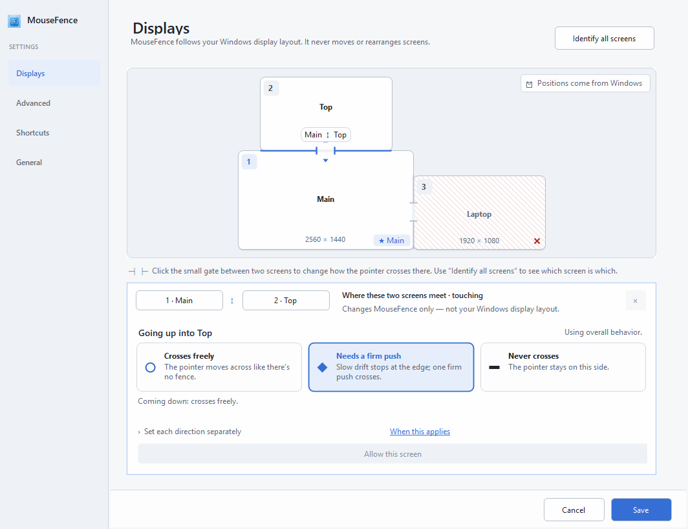
  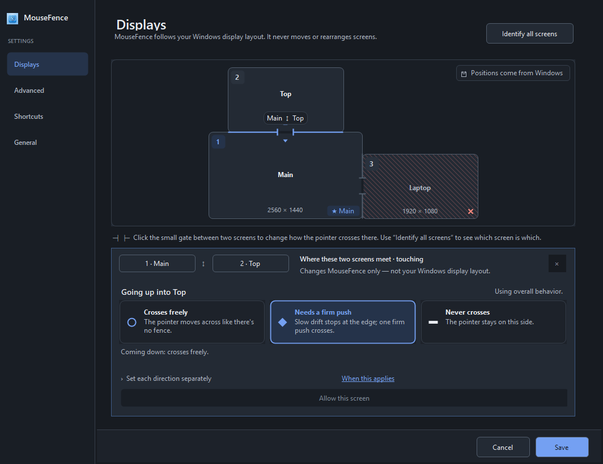
</p>

### Advanced

<p>
  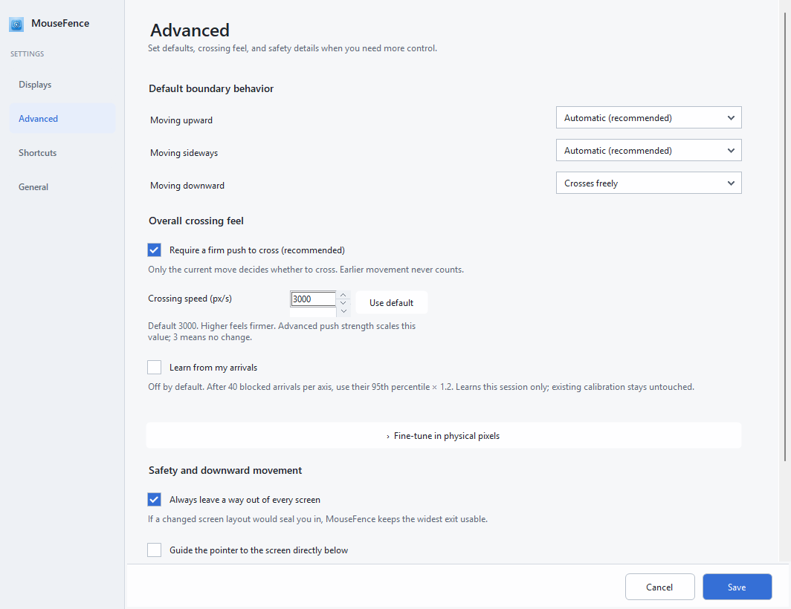
  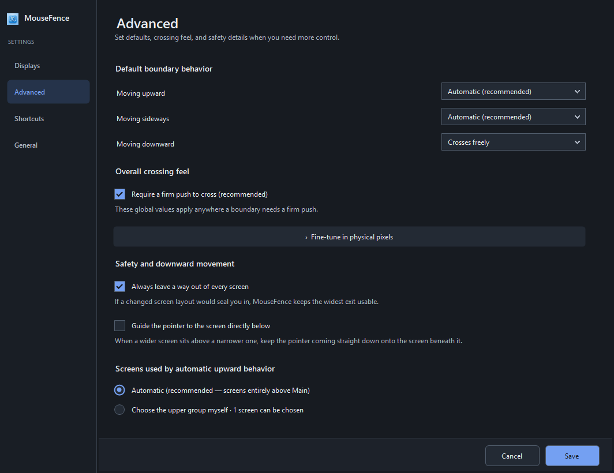
</p>

### Shortcuts

<p>
  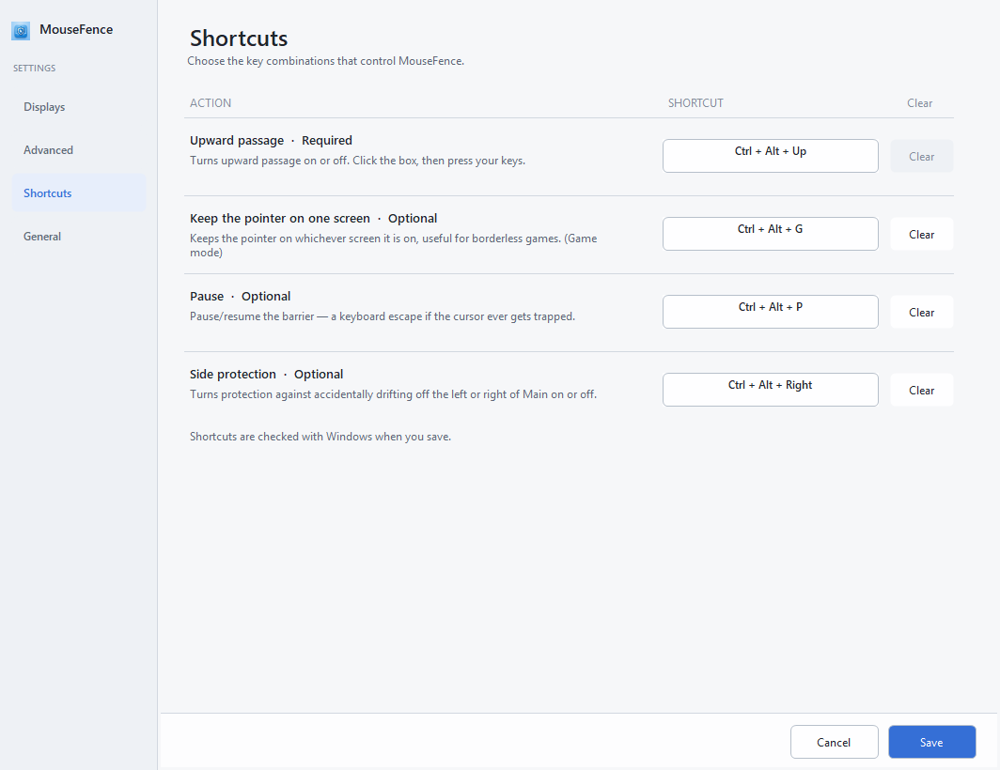
  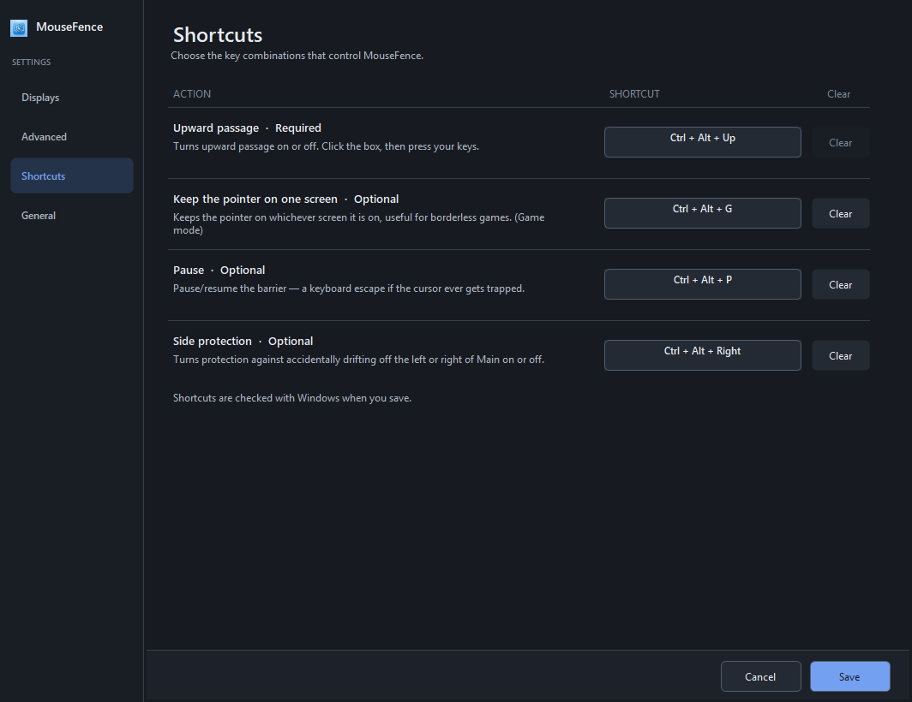
</p>

### General

<p>
  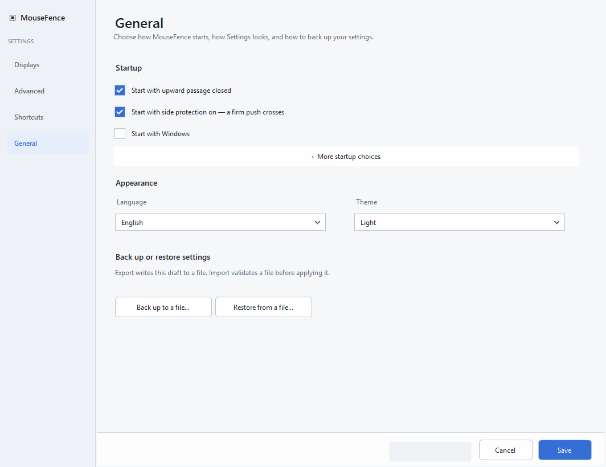
  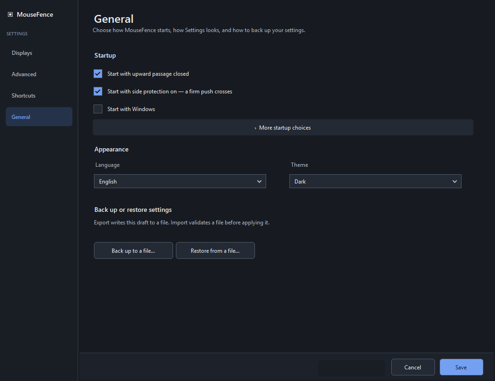
</p>

### Turkish

<p align="center">
  
</p>
</details>

## Questions and troubleshooting

**The pointer still slips between screens.**
Turn off Windows **Settings → System → Display → Multiple displays → Ease cursor movement between displays**.
It moves the pointer on its own and works against the fences.

**A firm-push edge does not let me through.**
Check in the tray menu that MouseFence is not paused and that the edge is set to **Needs a firm push**, not
**Never crosses**. Push straight across the middle of the shared edge, not diagonally near a corner.

**It does nothing over a game or an administrator window.**
Windows does not let a normal app steer the pointer over exclusive-fullscreen games or over programs running
as administrator. Windowed and borderless games work. Run MouseFence as administrator only if you need it over
an elevated program.

**The pointer cannot reach one of my screens.**
Open **Displays**: that screen is probably marked **Keep pointer off**, or the edge to it is **Never crosses**.

**Do mixed-DPI monitors work?**
Yes. MouseFence is per-monitor DPI-aware and works in physical pixels.

**It will not start and says the settings file is invalid.**
MouseFence never overwrites a settings file it cannot read. Restore a backup from **General → Restore from a
file**, or delete `%APPDATA%\MouseFence\settings.json` to start fresh. Details are in `error.log`.

**Settings changes do not stick.**
Saving replaces the file in one step; if the save fails, the previous settings stay active and the reason is in
`error.log`. **Start paused** and **Start in game mode** apply from the next launch.

## Privacy

MouseFence has no network code: it sends nothing anywhere and has no telemetry or update check. It reads
pointer movement through a standard Windows mouse hook to apply the fences, and only stores your settings and a
small error log in `%APPDATA%\MouseFence\`.

## How it works

MouseFence installs a low-level mouse hook (`WH_MOUSE_LL`). `BoundaryGraph` turns your saved rules into
directed edges between the real screen rectangles, and the Win32-free `GuardCore` decides for each movement
whether it passes, stops at the edge, or lands on an allowed screen. Game mode uses the same core to hold the
pointer on one screen. It reads screen positions and stable monitor identities, and never calls the Windows
functions that rearrange displays or change display modes.

## Build from source

You need Windows and the [.NET 9 SDK](https://dotnet.microsoft.com/download/dotnet/9.0).

```powershell
git clone https://github.com/ydbilgin/MouseFence.git
cd MouseFence
dotnet run -c Release
```

A single-file exe that uses the shared .NET runtime, like the release:

```powershell
dotnet publish -c Release -r win-x64 --self-contained false -p:PublishSingleFile=true
```

Or one that carries its own runtime:

```powershell
dotnet publish -c Release -r win-x64 --self-contained true -p:PublishSingleFile=true -p:EnableCompressionInSingleFile=true
```

**Tests.** The test project is a console program, so use `dotnet run`, not `dotnet test`:

```powershell
dotnet run --project tests/MouseFence.Tests.csproj -c Release
```

It covers edge rules, firm-push thresholds, side protection, safety escapes, settings migration, the
English/Turkish texts, and the screenshot pictures.

**Screenshots.** The README pictures come from the app itself, drawn off-screen with made-up screens; nothing
is read from your monitors:

```powershell
dotnet build MouseFence.csproj -c Release -o STAGING/_build/main
STAGING/_build/main/MouseFence.exe --screenshot-demo docs/screenshots/displays-dark.png Dark 0 en
STAGING/_build/main/MouseFence.exe --screenshot-tray docs/screenshots/tray-menu-dark.png Dark en
```

The view number is `0` Displays, `1` Advanced, `2` Shortcuts, `3` General, `-1` edge editor, and `-2`
Advanced with the physical-pixel controls open. The last argument is `en` or `tr`.

**Demo GIF.** `docs/demo.gif` is an animation drawn from `docs/demo/scene.html`; re-render it with
`node docs/demo/render.mjs`. See [docs/demo/README-demo.md](docs/demo/README-demo.md).

## Contributing

Contributions are welcome. Keep pointer decisions in the Win32-free `GuardCore`, add or update a scenario in
`tests/Tests.cs`, run the test program, and try the real pointer feel on Windows when behaviour changes. The
hook ignores simulated input on purpose, so real feel cannot be tested with fake mouse events.

## License

[MIT](LICENSE)
